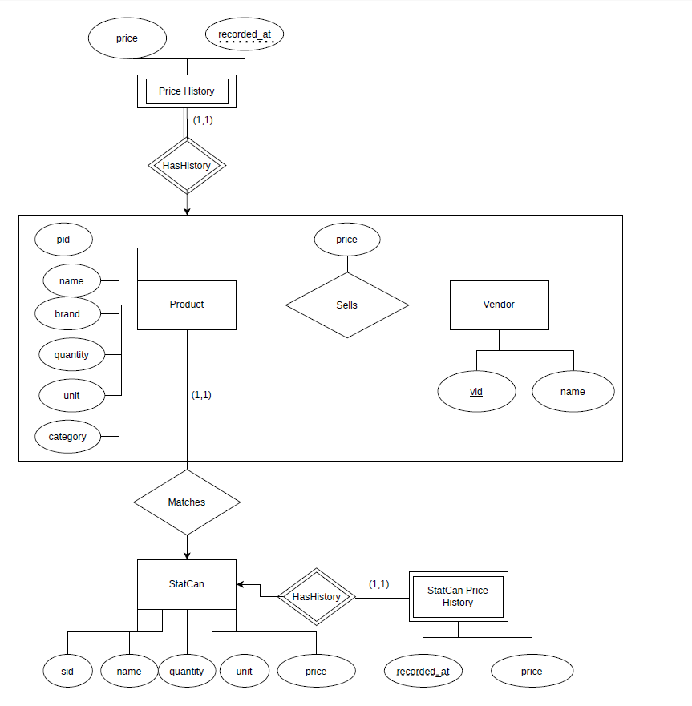

# cs348-project

SmartCart, a grocery budgeting web app for CS 348 (Fall 2026). The milestone reports are submitted on Learn; this repo holds the code.

## Repository layout

The repo is organised by component rather than by milestone: each milestone builds on the same database and app.

| Folder | Contents |
|---|---|
| `db/` | MySQL schema, sample data, reset script, and the feature queries with their output (`test-sample.sql`, `test-sample.out`) |
| `backend/` | Node.js API server (Express + mysql2) |
| `frontend/` | Web interface (React + Vite 6) |

## Database setup (local MySQL)

Requires MySQL 8.0 or newer. We develop on MySQL 9.7 LTS.

### 1. Install and start MySQL

macOS (Homebrew):

```bash
brew install mysql@9.7
brew services start mysql@9.7
mysql_secure_installation   # answer "no" to VALIDATE PASSWORD, then set a root password
```
Windows:

On https://dev.mysql.com/downloads/mysql/:
1. Select Version: `9.7.4 LTS` and Select Operating System: `Microsoft Windows`
2. Download the Windows MSI Installer
3. In the wizard, when you get to the `Choose Setup Type` step, select `Typical`
4. Install
5. Once you are in the MySQL Server Configurator, proceed with the default options for `Data Directory` and `Type and Networking`
6. At the `Accounts and Roles` step, set a root password
7. Continue with defaults for the rest of the steps

On other platforms, install MySQL Community Server from https://dev.mysql.com/downloads/mysql/.

### 2. Create the database and app user (one time)

```bash
mysql -u root -p
```

```sql
CREATE DATABASE smartcart;
CREATE USER 'smartcart'@'localhost' IDENTIFIED BY 'smartcart_dev';
GRANT ALL PRIVILEGES ON smartcart.* TO 'smartcart'@'localhost';
EXIT;
```

### 3. Create the tables and load the sample data

```bash
./db/reset.sh
```

On Windows, run the shell scripts from WSL; see [Windows: running the shell scripts with WSL](#windows-running-the-shell-scripts-with-wsl).

Successful output:
```
Recreating database smartcart...
Creating tables...
Loading sample data...
+---------------------+------+
| tbl                 | rows |
+---------------------+------+
| StatCan             |    5 |
| StatCanPriceHistory |   11 |
| Product             |    5 |
| Vendor              |    3 |
| Sells               |   12 |
| PriceHistory        |    9 |
+---------------------+------+
Done.
```

This drops and recreates every table, then loads the toy dataset. Run it again any time to get back to a clean state.
To use a different user/password, set `DB_USER` / `DB_PASSWORD` (and `DB_NAME`, `DB_HOST`) before running it.

| File | Contents |
|---|---|
| `db/schema.sql` | `CREATE TABLE` statements with keys, foreign keys and `CHECK` constraints |
| `db/sample-data.sql` | Hand-made sample rows (not real prices) |
| `db/reset.sh` | Recreates the database, runs both files and prints a row count per table |
| `db/test-sample.sql` | One sample query per feature |
| `db/test-sample.out` | Output of `test-sample.sql` on the sample data |

To regenerate `test-sample.out` after changing the queries or sample data:

```bash
./db/reset.sh
MYSQL_PWD=smartcart_dev mysql -u smartcart smartcart -t -vvv --skip-comments < db/test-sample.sql > db/test-sample.out
```

To poke around: `mysql -u smartcart -p smartcart` (password `smartcart_dev`).

## Production database

The production database `smartcart_prod` holds real prices: about 5,800 products, 7,300 current prices and 4 million daily price records from 9 Toronto-area grocers, matched to Statistics Canada's national average prices. It uses the same `db/schema.sql` as the sample database, which stays untouched.

Sources:
- [Project Hammer](https://www.projecthammer.org/get-the-data.html): daily grocery prices scraped since February 2024 (`hammer-5-csv.zip`, about 540 MB zipped, 4 GB unzipped)
- [Statistics Canada table 18-10-0245-01](https://www150.statcan.gc.ca/t1/tbl1/en/tv.action?pid=1810024501): monthly average retail prices for 110 food and household items, Canada-wide

The raw data is too big for the repo, so you download it and build the tables yourself. Building needs Python 3.9 or newer (standard library only) and about 5 GB of free disk space.

### 1. One-time MySQL setup (as root)

```sql
CREATE DATABASE smartcart_prod;
GRANT ALL PRIVILEGES ON smartcart_prod.* TO 'smartcart'@'localhost';
SET PERSIST local_infile = 1;   -- lets load.sh bulk-load CSV files
```

### 2. Download, build and load

```bash
db/production/download.sh            # into db/production/raw/ (git-ignored); resumes if interrupted
python3 db/production/build.py       # writes CSVs and build-report.txt to db/production/out/ (about 2 minutes)
db/production/load.sh                # recreates smartcart_prod and loads the CSVs (about 20 seconds)
```

On Windows, run these from WSL; see [Windows: running the shell scripts with WSL](#windows-running-the-shell-scripts-with-wsl).

To point the app at production data, set `DB_NAME=smartcart_prod` in `backend/.env`.

To regenerate `test-production.out`:

```bash
MYSQL_PWD=smartcart_dev mysql -u smartcart smartcart_prod -t -vvv --skip-comments < db/test-production.sql > db/test-production.out
```

### How the data is cleaned

`build.py` makes these decisions; `build-report.txt` counts the rows affected by each one.

- **Matching to StatCan.** Each product must match exactly one StatCan item (`Product.sid` is `NOT NULL`). `statcan_rules.csv` gives each item a name pattern, words to exclude and a category. Packaged items must also be within 10% of the StatCan package size; for example, "Butter, 454 grams" accepts 409–499 g. Listings that match no item, or more than one, are dropped.
- **Per-kilogram and per-unit items.** Produce and meat that StatCan prices per kilogram are stored as 1 kg, using the store's per-weight price. Items priced per unit (avocado, lemons) must be sold singly.
- **One product, many stores.** Listings with the same UPC become one `Product` with a `Sells` row per store, so the basket and compare features can price the same item at different stores.
- **Prices.** One price per product, store and day. The script skips multi-buy prices ("2/$7.00"), prices more than 3× away from that listing's median (Walmart sometimes shows $2.98 as $298), and prices far outside the StatCan benchmark. `Sells.price` is the latest price. Store listings with no price in the last 30 days are dropped.
- **StatCan.** Canada-wide rows only. `StatCan.price` and `reference_month` repeat the latest `StatCanPriceHistory` row.

| File | Contents |
|---|---|
| `db/production/download.sh` | Downloads both raw datasets |
| `db/production/build.py` | Cleans and matches the raw data, writes one CSV per table |
| `db/production/statcan_rules.csv` | Name patterns that match grocery listings to StatCan items |
| `db/production/load.sh` | Recreates `smartcart_prod` from `db/schema.sql` and bulk-loads the CSVs |
| `db/test-production.sql` | The feature queries with production pids (first 10 rows where results are long) |
| `db/test-production.out` | Output of `test-production.sql` on the production database |

## Windows: running the shell scripts with WSL

The scripts in `db/` (`reset.sh`, `production/download.sh`, `production/load.sh`) are bash scripts, so on Windows you run them in WSL (Windows Subsystem for Linux). Only the scripts run in Linux. MySQL, the repo and the app all stay on Windows: the scripts connect to your Windows MySQL over `127.0.0.1`, and the databases they create are ordinary databases on it, visible from Workbench and the app.

This needs Windows 11 22H2 or newer (run `winver` to check), for the mirrored networking in step 3.

### 1. Install Debian and make it the default distro

In PowerShell, run as Administrator:

```powershell
wsl --install -d Debian    # installs WSL too if it isn't there yet; reboot if asked
wsl --update               # mirrored networking needs WSL 2.0 or newer
```

When the Debian window opens for the first time, it asks for a Linux username and password. These are only for Debian (you type the password for `sudo`); they don't have to match your Windows login.

If Docker Desktop is installed, `wsl -l -v` also lists a `docker-desktop` distro. That is Docker's internal VM, and it can't run these scripts. If it is the default (marked `*`), a bare `wsl` command opens it instead of Debian, so make Debian the default:

```powershell
wsl --set-default Debian
wsl -l -v                  # Debian should have the *, and VERSION 2
```

Docker Desktop keeps working; it doesn't depend on the default distro.

### 2. Install the tools the scripts need (inside Debian)

Open Debian (Start menu → Debian, or run `wsl` in PowerShell) and run:

```bash
sudo apt update && sudo apt upgrade -y
sudo apt install -y curl unzip python3 default-mysql-client
```

| Package | Used by |
|---|---|
| `curl`, `unzip` | `db/production/download.sh` |
| `python3` | `db/production/build.py` |
| `default-mysql-client` | the `mysql` command in `reset.sh`, `load.sh` and the test commands (Debian ships the MariaDB client under this name; it works with MySQL) |

Don't install a MySQL server in Debian; you use the one on Windows. You don't need git in Debian either, because the repo stays where Windows git cloned it.

Make the `mysql` command connect to Windows MySQL by default, so the commands in this README work unchanged:

```bash
printf '[client]\nhost=127.0.0.1\n' >> ~/.my.cnf
```

### 3. Let Debian reach MySQL on Windows (mirrored networking)

By default, `127.0.0.1` inside WSL is the Linux VM, not Windows. Mirrored networking makes it point at Windows. In PowerShell:

```powershell
notepad "$env:USERPROFILE\.wslconfig"
```

Let Notepad create the file if it asks, add these two lines (keep anything already there), and save:

```ini
[wsl2]
networkingMode=mirrored
```

Then restart WSL:

```powershell
wsl --shutdown
```

Check the connection from Debian:

```bash
MYSQL_PWD=smartcart_dev mysql -h 127.0.0.1 -u smartcart -e "SELECT VERSION(), @@local_infile"
```

This should print your Windows MySQL version. `@@local_infile` must be `1` before you run `load.sh`; if it is `0`, run the root setup in [Production database](#production-database).

### 4. Check the line endings of your clone (one time)

`.gitattributes` makes git check out the scripts, SQL and output files with Linux (LF) line endings. A clone made before `.gitattributes` was added may still have Windows (CRLF) endings, and then the scripts fail with `/usr/bin/env: 'bash\r': No such file or directory`. Check from Debian, in the repo folder:

```bash
head -1 db/reset.sh | od -c | tail -2
```

If the line ends in `\r  \n` instead of just `\n`, re-check out the files in PowerShell, in the repo folder. `git reset --hard` discards uncommitted changes, so commit or stash first if `git status` shows any:

```powershell
git status
git rm --cached -r -q .
git reset --hard
```

### 5. Run the scripts

Your Windows drives appear in Debian under `/mnt`; for example, `C:\Users\you\cs348-project` is `/mnt/c/Users/you/cs348-project`.

In VS Code, open a Debian terminal: click the **⌄** next to **+** in the terminal panel and choose **Debian (WSL)**. It opens in the repo folder. (Don't use the ▶ Run button or a PowerShell terminal; those run on Windows, without bash.) Then run the scripts as in the sections above:

```bash
bash db/reset.sh
bash db/production/download.sh
python3 db/production/build.py
bash db/production/load.sh
```

To check that you are in Debian and the tools are installed:

```bash
grep PRETTY_NAME /etc/os-release && which curl unzip python3 mysql
```

### Troubleshooting

| Symptom | Fix |
|---|---|
| `wsl` opens something without `apt`, or `wsl -l -v` lists only `docker-desktop` | Debian isn't installed or isn't the default; see step 1. Or open it by name: `wsl -d Debian` |
| `/usr/bin/env: 'bash\r': No such file or directory` | CRLF line endings; see step 4 |
| `Can't connect to MySQL server on '127.0.0.1'` | Mirrored networking isn't on (step 3), or MySQL isn't running on Windows (Services app → the MySQL service, e.g. `MySQL97` → Start) |
| `Can't connect to local server through socket` | The `mysql` command ran without `-h 127.0.0.1`; add the `~/.my.cnf` line from step 2 |
| `local_infile is OFF on the server` | Run `SET PERSIST local_infile = 1;` as root on the Windows MySQL |
| `mysql: command not found` | Install `default-mysql-client` (step 2), and check you are in Debian, not `docker-desktop` |

## Running the application

Requires Node.js 20 or newer, and the database from the steps above.

### Backend (Express + mysql2, port 3001)

```bash
cd backend
npm install
cp .env.example .env    # database connection settings; edit if yours differ
npm start               # or `npm run dev` to restart on file changes
```

Check it with `curl localhost:3001/api/health`, which should print `{"status":"ok","products":5}`.

### Frontend (React + Vite 6, port 5173)

In a second terminal:

```bash
cd frontend
npm install
npm run dev
```

Open http://localhost:5173. The Vite dev server forwards `/api` requests to the backend, so start the backend first.

### Features currently supported

| Feature | Where | API |
|---|---|---|
| 1. Search and filter groceries by name, brand and category | `backend/src/routes/products.js`, `Search` in `frontend/src/App.jsx` | `GET /api/products?q=&brand=&category=` |
| 2. Shopping basket: add/remove products, change quantities, see the estimated total at a chosen retailer | `backend/src/routes/basket.js`, `Basket` in `frontend/src/App.jsx` | `POST /api/basket/quote` |

Supporting endpoints: `GET /api/products/filters` (brand and category lists), `GET /api/vendors`, `GET /api/health`.

E/R Diagram:

